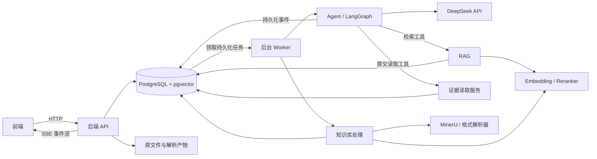
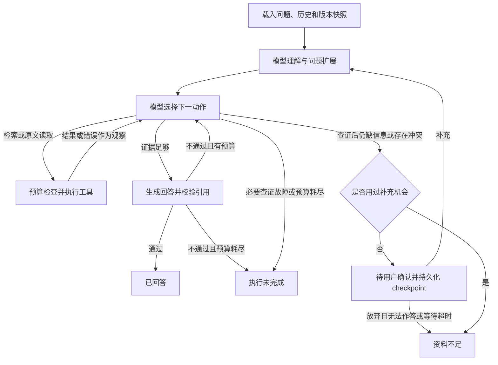

# 企业知识问答 Agent：模块化开发设计

日期：2026-10-31。状态：**考生已要求按本方案开发，已完成一期代码和离线工程验证；真实模型效果待验证。**

实现入口与差异见 [README](../README.md)、[实际评估](03-evaluation.md)、[独立审查](review-notes.md)。以下保留原方案及参数依据。

依据：[业务需求](01-requirements.md)、[考核要求](../exam.md)、[知识库材料](../data/README.md)。本文承接已确认的业务规则；本轮开发依据考生“按照当前的方案设计进行开发”的授权执行。

## 1. 审阅摘要

采用 **HTTP API + 模块化单体后端 + 独立后台 Worker**。代码按五个模块隔离，共用 PostgreSQL；暂不拆成多个业务微服务。

| 模块 | 考生指定的方向 | 本文补充的建议 |
| --- | --- | --- |
| 前端 | 页面、对话框、知识库选择、拖动上传、Trace 可视化 | React + TypeScript；HTTP 提交，SSE 接收 Trace |
| Agent | DeepSeek API、LangGraph、复用或自建工具 | 模型决定下一动作；复用状态图、工具执行、中断和持久化机制 |
| 后端 | PostgreSQL + pgvector；版本、文档、chunk、行锁与调度 | FastAPI；不可变知识库快照；数据库任务队列；短事务 |
| 知识库处理 | 上传或配置触发脚本；分格式处理；PDF 用 MinerU 和空间分块 | 统一中间结构、可追溯原文定位；脚本与 Worker 共用处理入口 |
| RAG | 问题扩展、关键词 + 向量检索、rerank | Agent 扩展问题；RAG 执行检索；RRF 融合后重排 |

**优先审阅三项建议：**

1. Embedding 与 rerank 分别采用 BGE-M3、bge-reranker-v2-m3；DeepSeek 负责理解、决策和回答，三者分别封装适配器。
2. 知识库先完整构建新版本，再原子发布；每次问题固定版本，避免读到半成品。
3. 第一期采用单知识库问答、`.docx` Word 文件和本地文件存储；多库联合检索、旧 `.doc` 转换不列入首期。

前端是本次新增的开发范围，虽然考核本身不强制要求界面。**纠错记忆、知识图谱构建仅保留 TODO**，不进入首期回答链路。超时和调用上限见第 8 节，均为可调整的初始建议。

## 2. 模块边界与调用关系



| 模块 | 负责 | 不承担的业务职责 |
| --- | --- | --- |
| 前端 | 输入、上传进度、任务状态、引用和 Trace 展示 | 不自行判断证据是否充分或结束状态 |
| 后端 | HTTP 契约、文件与版本管理、任务调度、事务、事件读取 | 不用固定分支代替模型选择检索或查证动作 |
| Agent | 承接上下文、扩展问题、选择工具、判断证据、回答或补充 | 不直接拼 SQL，不自行决定制度优先级 |
| 知识库处理 | 解析、清洗、分块、索引、质量检查 | 不把摘要或模型改写内容冒充制度原文 |
| RAG | 关键词与向量召回、融合、重排、返回候选 | 不裁决冲突，不决定任务最终状态 |

复用 LangGraph 的图执行、工具执行机制和 PostgreSQL checkpointer；检索、原文读取、版本约束和 Trace 事件适配由项目实现。LangGraph 的短期 checkpoint 不等于未来的“纠错记忆”。参考：[LangGraph 持久化](https://docs.langchain.com/oss/python/langgraph/persistence)。

## 3. 前端与 HTTP API

### 3.1 页面组成

- **知识库区**：选择知识库，显示当前发布版本、文档列表；拖动上传，查看解析/索引/失败状态；编辑分块等配置并发起重建。
- **对话区**：问题与历史、回答、引用、资料缺口、业务状态；等待补充时显示截止时间，以及“提交补充”“放弃补充”。
- **Trace 区**：按时间显示问题扩展、检索、原文读取、工具错误、下一动作和简要依据；细节按需展开。
- **证据面板**：展示实际读取的原文、文档 ID、版本日期和位置；PDF 支持页码与区域定位，其他格式支持章节、条款或段落定位。

一期每个会话绑定一个知识库，切换知识库时创建新会话，避免把其他库的历史当成当前证据。同一会话有运行或待补充的问题时，不再创建第二个问题；不同会话可以并行。

### 3.2 API 草案

统一前缀 `/api/v1`；ID 由服务端分配。创建任务返回 `202 Accepted`，前端继续获取状态，不等待解析或问答完成。

| 方法与路径 | 输入 / 输出摘要 |
| --- | --- |
| `GET /knowledge-bases`、`POST /knowledge-bases` | 列出 / 创建知识库 |
| `GET /knowledge-bases/{id}/versions` | 发布版本、构建版本与失败原因 |
| `GET /knowledge-bases/{id}/documents?version_id=…` | 指定快照内的文档及修订 |
| `POST /knowledge-bases/{id}/uploads` | multipart 文件及元数据；返回 `upload_id`；这里只保存并校验文件 |
| `POST /knowledge-bases/{id}/builds` | `base_version_id`、上传 ID、明确的新增/替换/移除清单、配置；返回 `job_id, version_id` |
| `GET /jobs/{job_id}` | 构建阶段、进度、错误；页面短轮询 |
| `POST /knowledge-bases/{id}/versions/{version_id}/publish` | `expected_current_version_id`；发布已就绪版本 |
| `POST /conversations`、`GET /conversations/{id}` | 创建绑定知识库的会话 / 获取历史及当前任务 |
| `POST /conversations/{id}/runs` | `question`；服务端捕获当前发布版本，返回 `run_id, events_url` |
| `GET /runs/{run_id}` | 执行状态、业务状态、结果、补充期限、最后事件序号 |
| `POST /runs/{run_id}/clarification` | `action=submit/abandon`、补充内容；可显式附带新发布的 `version_id` |
| `GET /runs/{run_id}/events` | SSE；支持 `Last-Event-ID`，首次可用 `after_seq` |
| `GET /knowledge-bases/{id}/versions/{version_id}/documents/{document_version_id}/source` | 已授权版本的原文与定位；不接受任意磁盘路径 |

“上传并构建”由前端顺序调用上传、构建两个 API，可把多个文件纳入同一版本。默认构建成功后尝试自动发布；若基线已变化，保留就绪版本并返回发布冲突，不覆盖别人已发布的内容。

写请求使用 `Idempotency-Key`：同一作用域、同一键和请求体返回原结果；同一键对应不同请求体返回 `409`。错误统一包含 `code, message, retryable, request_id`。不支持格式返回 `415`，体积超限返回 `413`，缺失必要元数据返回 `422`。

### 3.3 状态与回答契约

`execution_status` 表示内部执行进度：`queued / running / waiting / finished`。`task_status` 表示业务结论：

| API 值 | 页面文字 | 何时出现 |
| --- | --- | --- |
| `answered` | 已回答 | 完成有证据的回答 |
| `awaiting_user` | 待用户确认 | 唯一一次补充窗口已开启 |
| `incomplete` | 执行未完成 | 故障或预算耗尽导致必要查证未完成 |
| `insufficient` | 资料不足 | 补充后仍缺依据、仍冲突、放弃且无法作答或等待超时 |

排队和运行时 `task_status=null`，不增加第五种业务状态。结果字段固定为 `answer, citations[], information_gaps[], task_status, reason_code`；等待时另含 `clarification_id, questions[], deadline_at`。

每条引用保存 `evidence_id, kb_version_id, document_id, document_version_id, version_date, chunk_id, locator, quote`。`document_id` 是 D01 等业务标识；`document_version_id` 才标识实际修订。页面显示版本日期，内部不能只靠日期定位。

### 3.4 Trace 同步

事件采用 `run_id, seq, event_id, occurred_at, type, node, step, tool_call_id, payload`。主要类型：`run.started`、`query.expanded`、`tool.started`、`tool.completed`、`tool.failed`、`agent.decision`、`clarification.requested`、`run.finished`。

事件先写 PostgreSQL，提交后才能经 SSE 发出；同一 run 的 `seq` 严格递增，前端按序号去重、断线续读。SSE 心跳建议每 15 秒发送一次；浏览器断线不取消任务，刷新后从结果 API 与事件表恢复。第一期不逐 token 输出未经校验的答案，最终答案校验完成后展示。

Trace 只含工具参数、返回摘要、计数、耗时和简短动作依据；不展示模型内部思维文本、密钥或完整调试 state。完整证据通过引用面板读取。LangGraph 流式事件须转成项目事件契约，不能直接将框架调试输出发送给前端。参考：[LangGraph Streaming](https://docs.langchain.com/oss/python/langgraph/streaming)。

## 4. Agent 模块：理解、决策与有界执行

### 4.1 状态图与动态决策



图提供执行骨架和硬性约束；模型根据观察选择工具、查询词、读取范围及是否结束。调用失败不会由路由器直接变成“资料不足”。进入 `insufficient` 的前提是已完成必要查证且遵守一轮补充规则；存在未恢复的必要工具故障时进入 `incomplete`。

Agent state 至少包含：`run_id, conversation_id, messages, original_question, resolved_question, expanded_queries, unresolved_slots, kb_version_id, evidence_epoch, observations, evidence_refs, clarification_count, deadline_at, model_call_count, tool_call_count, graph_step_count, active_elapsed_ms, result`。LangGraph 的 `thread_id=run_id`，会话历史由业务层载入；新问题使用独立预算，同一问题补充恢复沿用原预算。

### 4.2 问题扩展与工具

扩展结果最多为“原始问句 + 1 个上下文补全问句 + 1 个同义问句”。例如前文为上海住宿上限，本轮“那试用期员工呢？”补全为“试用期员工在上海出差的住宿报销上限是多少”。只从当前输入和可追溯历史补全条件，未知城市、身份、审批状态进入 `unresolved_slots`，不能猜测。扩展词用于检索，不产生制度事实。

| 工具 / 接口 | 参数 | 结果与边界 |
| --- | --- | --- |
| `search_knowledge` | 查询列表、可选文档过滤条件 | RAG 候选 ID、标题、位置、分数和检索诊断；仅候选，不登记为已读证据 |
| `read_document` | 文档修订、chunk/章节/邻接范围 | 原文块、定位、`evidence_id`；支持按页或章节读长文档，限制总返回量 |
| `request_clarification` | 缺口、集中询问的问题 | 经过一次性门禁后挂起；不是普通外部工具 |
| `finish_answer` | 回答、证据 ID、逐项引用、状态建议 | 服务端校验引用、状态与剩余预算后落盘 |

工具的知识库和版本由服务端注入，模型不能改写；不能访问任意 URL、数据库或文件系统。读取工具也能按文档 ID 查证跨文档引用，不局限于首轮 Top-K。单次读取初始限制为 10,000 tokens，超长内容分页读取并明确返回未读范围。服务端强制校验合法状态迁移；模型不能跳过补充机会直接结束为“资料不足”。预算检查放在每个执行节点入口，预算耗尽后的结果落盘不再调用模型。

DeepSeek 通过适配器配置 `base_url, model, api_key, timeout`。2026-11-01 按考生要求调整为默认开启思考模式：问题扩展和 Agent 决策均发送 `thinking.type=enabled`，默认 `reasoning_effort=high`、`max_tokens=16384`，可通过 `.env` 调整并写入每个 run 的配置快照。思考模式使用 `tool_choice=auto`，不能使用 `required` 或指定工具；模型只生成调用请求，工具由应用执行。输出截断或异常结束时不执行该响应中的工具。

带工具的模型消息完整保存 `reasoning_content` 并在后续请求逐字回传，包括没有工具调用的 assistant 消息和用户补充后的请求。该字段只存于后端动作账本与 checkpoint，不进入对外会话、Trace 或 CLI 导出。问题扩展是独立、无工具的 JSON 请求，仅返回公开扩展字段。每个 `tool_call_id` 必须匹配一个结果；保留一次一个工具的策略，模型返回多个调用时逐项反馈“本轮未执行”，再要求重选；没有调用工具的直接回答不绕过引用校验，须继续调用 `finish_answer`。

每个问题仍有独立 run、预算与证据。相同会话、知识库版本及模型/思考配置的新问题，从上一个已完成且协议完整的 checkpoint 续接模型消息，追加新用户问题，并要求重新读取本轮引用。模型/版本变更、旧协议或不完整历史从公开会话记录重建新上下文，不拼接无法闭合的工具历史；同一 run 的补充与 Worker 恢复保留完整私有上下文，证据 epoch 变化时沿用原设计重建上下文。已有 live run 缺少新配置快照或恢复配置不一致时返回 `CONFIG_MISMATCH`，用户需重新提问。参考：[DeepSeek Tool Calls](https://api-docs.deepseek.com/guides/tool_calls/)、[Thinking Mode](https://api-docs.deepseek.com/guides/thinking_mode/)、[多轮对话](https://api-docs.deepseek.com/guides/multi_round_chat/)、[Chat Completions 参数](https://api-docs.deepseek.com/api/create-chat-completion/)。实际验证范围记录在 [AI 使用记录](04-ai-usage.md)。

### 4.3 证据校验与补充恢复

- 最终引用只能引用本轮证据集合中成功读取的原文。服务端核对版本、范围和片段是否存在；模型判断结论与适用条件是否由片段支持。字符串校验不等于语义正确，仍须用评测核验。
- 检索内部重排需要正文，但默认给 Agent 的检索结果仅为元数据，随后通过 `read_document` 正式取证。这样“读取失败”不会被检索摘要或缓存旁路绕过，能够实现 QA19/QA20。
- 发现 D01/D02 冲突后，模型查找适用条件或明确替代依据；版本日期和 rerank 分数都不能裁决冲突。历史回答、用户口头确认不能替代制度原文。
- 第一次补充请求先持久化请求、截止时间与中断状态，再对外显示“待用户确认”；等待期间释放 Worker。恢复使用同一问题的 LangGraph thread，补充次数不重置。
- 普通补充继续使用原快照。如果补充包含新上传的制度，先完成构建发布，再由补充请求明确指定新版本；记录版本变更，增加 `evidence_epoch`，清空当前可引用证据并重新检索读取。旧证据只保留在审计记录，不与新快照混合成最终回答。
- 用户上传尚未就绪时不恢复 Agent；等待期限继续计算。超时后该问题已结束，后来的补充须创建新问题。

LangGraph `interrupt()` 默认可无限等待，期限必须由后端实现；恢复时中断所在节点会重新执行，因此通知、Trace 和状态写入必须幂等。参考：[LangGraph Interrupts](https://docs.langchain.com/oss/python/langgraph/interrupts)。

## 5. 知识库处理模块

### 5.1 构建入口与流水线

计划提供 `scripts/ingest.py --job-id <id>`，只接受服务端创建的任务 ID。CLI 和 Worker 调用同一 `IngestionService`；请求处理线程不直接执行长时间解析。该命令目前为拟定入口，尚不可运行。

流程：**上传校验 → 固化文件与元数据 → 建立目标版本清单 → 格式解析 → 统一原文块 → 分块 → 中文分词与 Embedding → 数据完整性检查 → 就绪 → 原子发布**。

原文件按内容哈希存储，保留上传名称；文档 ID、版本日期、适用范围等优先读取文档元数据，缺失或冲突时要求上传者补齐，不能由模型猜测。目标版本清单在入队时冻结，后续上传不会自动混入正在构建的版本。

解析、分块、Embedding 或分词配置变化触发新构建；rerank、Top-K 等查询参数变化只生成新的问答配置修订，不强制重切 chunk。每次问答保存完整配置快照。

### 5.2 统一中间结构

解析器统一输出 `DocumentIR`，包含文档元数据以及有序 `blocks[]`。每个原文块至少有：

`block_id, type, text, heading_path, order, locator, parent_id, parser_version`。

`locator` 按格式保存行号、段落/表格索引、DOM 路径，或 PDF 页码、bbox、坐标系与页面尺寸。展示页码统一从 1 开始，适配器负责转换解析工具的页码。另保存清洗前后偏移映射；索引清洗文本与可引用原文分开存储。

chunk 保存原文块 ID 列表、范围及标题路径；模型摘要、标题补充可帮助检索，但不能进入原文引用字段。表格拆行必须携带表头，不能把金额与对应城市或条件拆散。

### 5.3 五种格式策略

| 格式 | 解析建议 | 分块策略 | 定位 |
| --- | --- | --- | --- |
| Markdown | Markdown AST，分离 front matter | 先按标题、条款、列表/表格确定边界，再做语义合并与切分 | 标题路径、条款、原始行号 |
| Word `.docx` | 读取段落样式、编号和表格，并保持交错顺序 | 按标题和条款建立段落单元，再做语义分块；表格独立保留关系 | 段落索引、标题路径、表格行列 |
| HTML | DOM 解析，优先正文 `article/main` | 以列表项、条款项、表格行组等 item 为单元，带上祖先标题；超长 item 再分割 | DOM 路径、item ID、条款 |
| PDF | MinerU 开源工具的结构化输出 | 按阅读顺序、标题层级、同栏空间邻近组织主体块；必要时在块内再切分 | 页码、bbox、块 ID |
| TXT | UTF-8 优先，其他编码明确识别，保留行号 | 识别标题和编号，句段向量驱动语义分块 | 行范围、条款或段落 |

“语义分块”建议实现为：先形成完整句段，计算相邻句段相似度，在明显语义变化或结构边界处分开，再按长度合并。短制度优先保留完整条款，不为了凑长度强制拆开。参数按 Embedding tokenizer 计算，初始目标 400 tokens、最大 800 tokens；相邻块最多重叠 80 tokens，且不跨文档或互不相关的章节。阈值与块大小均需通过样本调优。

PDF 按考生所述“主体分块（空间相近元素归组）”设计：先区分栏位与阅读序，再在同标题范围内合并临近块；跨页连续条款可按结构衔接，页眉页脚不参与正文合并。仅距离近不能合并两栏中的无关段落。缺失 bbox 时使用可靠的顺序与标题结构并记录降级；顺序也不可靠时构建失败，不能静默发布错误文本。

MinerU 输出通过版本化适配器转换；不假定不同发行版的 JSON 文件名、字段和坐标尺度完全相同。保留其原始结构化产物，锁定工具版本后编写转换契约测试。参考：[MinerU 输出格式](https://opendatalab.github.io/MinerU/reference/output_files/)。

### 5.4 质量、失败与资源边界

- 上传校验扩展名、真实文件类型、大小和可读性。加密 PDF、损坏文档、空正文、缺失必要元数据明确失败；一期旧 `.doc` 提示先转 `.docx`。
- HTML 去除脚本、导航和隐藏噪声，保留正文；不执行脚本或自动抓取外部资源。前端预览进行转义或安全渲染。
- 构建检查块数、原文映射、空块、向量维度和向量数量；PDF 抽查文本层/OCR 与页面，表格抽查标题、金额和条件。未完整处理目标清单中的所有文档时不发布。
- MinerU 放入独立进程，限制执行时间与资源，并可终止整个子进程组。解析/Embedding 失败仅影响新版本，旧发布版本继续可查询。
- 首期全量构建快照便于审计；可按“文件哈希 + 解析/分块/模型配置哈希”复用中间产物。复用不修改已有快照或旧引用。

## 6. RAG 模块

### 6.1 检索管线

1. **接收扩展查询**：Agent 提供原问句及最多两个变体，相同文本去重；RAG 不再自行扩写业务条件。
2. **双路召回**：每个查询分别进行关键词检索和向量检索，每路初始取 20 个候选；所有查询都强制限定知识库及版本。
3. **融合去重**：各路按排名使用 RRF：`score(c) = Σ 1 / (60 + rank(c))`；按 chunk ID 去重，最多保留 60 个候选。保留命中来源，避免直接相加不可比的分数。
4. **rerank**：用上下文补全后的主问题对候选重排，初始返回前 8 个；保留其他候选供模型进一步查证，不按日期或同主题强行去掉冲突文档。
5. **原文读取与判断**：模型选择读取条款、邻接块或章节，判断是否足够；不够时在预算内调整查询或读取范围。

重排分数只表示相关程度，不等于事实正确、制度优先级或作答置信度。单次未召回不能证明全库没有资料；最终缺口应描述实际查证范围。

### 6.2 关键词、向量和重排选型

| 能力 | 建议实现 | 约束 |
| --- | --- | --- |
| 中文关键词 | 应用层 jieba 分词，维护制度词典；预分词后进入 PostgreSQL `tsvector('simple')`，GIN 索引，`ts_rank_cd` 排序 | 文档和查询使用相同词典版本；召回使用安全构造的 OR 词查询，保留 ID、数字与关键术语 |
| 语句向量 | `BAAI/bge-m3` dense embedding，`vector(1024)`，余弦距离 | 同一快照的文档与查询必须使用相同模型修订及预处理；不自动使用其 sparse 输出替换关键词路线 |
| rerank | `BAAI/bge-reranker-v2-m3`，独立 `Reranker` 接口 | 单独配置批量、长度和超时；不能把分数当概率阈值直接结束任务 |

PostgreSQL 内置全文排序与 BM25 不是一回事，本方案不将 `ts_rank_cd` 标为 BM25；jieba 是本项目对中文分词的补充选择。依据：[PostgreSQL 全文检索](https://www.postgresql.org/docs/current/textsearch-controls.html)、[BGE-M3 模型卡](https://huggingface.co/BAAI/bge-m3)、[Reranker 模型卡](https://huggingface.co/BAAI/bge-reranker-v2-m3)。

当前 8 份短文档优先精确向量扫描，先验证效果；数据增长后再基于测量启用 HNSW。pgvector 的近似索引叠加过滤可能减少返回数量，启用时需验证迭代扫描、分区或回退精确查询，不能为了补足数量而取消版本过滤。参考：[pgvector 过滤与迭代扫描](https://github.com/pgvector/pgvector#filtering)。

Embedding 与 rerank 优先作为独立适配器运行，是否本机进程或独立推理服务取决于机器资源；实现前记录冷启动、内存与延迟。更换模型须生成兼容的新索引版本，不能混合向量空间。

### 6.3 降级与缓存

关键词或向量一路失败时，返回 `degraded=true`、成功候选及失败阶段；rerank 失败时可返回 RRF 顺序。由 Agent 根据实际证据判断能否完成，Trace 必须标明降级，验收另统计完整链路是否成功。两路均失败、或关键原文始终不可读且无法补救时，返回“执行未完成”。

查询缓存如启用，键必须包含知识库、版本、模型修订、检索配置哈希与查询文本；原文缓存必须包含文档修订和定位。故障测试禁用正文缓存旁路；首期可不开启查询缓存。

## 7. 后端数据、版本与并发调度

### 7.1 数据模型

以下为逻辑表设计，具体迁移尚未创建。主键采用 UUID，时间使用 `timestamptz`，配置使用 JSONB 并保存哈希。

| 表 | 核心字段 / 约束 |
| --- | --- |
| `knowledge_bases` | `id, name, current_version_id`；当前指针只能指向本库已就绪版本 |
| `kb_versions` | `id, kb_id, base_version_id, status, config_snapshot, config_hash, manifest_hash` |
| `documents` | `id, kb_id, document_id`；唯一 `(kb_id, document_id)` |
| `document_versions` | `id, document_fk, version_date, file_hash, storage_uri, metadata`；内容不可变 |
| `kb_version_documents` | `kb_version_id, document_fk, document_version_id`；每个快照每个逻辑文档只选一个修订 |
| `source_blocks` | `id, kb_version_id, document_version_id, text, locator, order`；保存可引用原文 |
| `chunks` | `id, kb_version_id, document_version_id, ordinal, text, source_ranges, search_vector, embedding`；唯一 `(kb_version_id, document_version_id, ordinal)` |
| `uploads` / `idempotency_requests` | 文件校验状态；请求作用域、幂等键、请求哈希、资源 ID；幂等键唯一 |
| `jobs` | `id, type, resource_id, status, attempts, max_attempts, next_attempt_at, lease_until, lease_token, worker_id` |
| `conversations` / `messages` | 绑定知识库、消息序号、角色、所属 run；同会话序号唯一 |
| `runs` | 版本、证据阶段、配置快照、执行/业务状态、调用预算、补充次数、期限、最终结果 |
| `run_actions` / `evidence_reads` | 动作 ID、计数预留、输入/输出摘要、成功读取的原文范围；动作 ID 唯一 |
| `clarifications` | `run_id, payload, status, deadline_at, response`；唯一 `run_id`，只允许一次补充窗口 |
| `trace_events` | `run_id, seq, event_id, payload`；唯一 `(run_id, seq)` 与 `event_id` |
| LangGraph checkpoint 表 | 使用官方 PostgreSQL saver 的表结构与迁移；和业务状态分开管理 |

引用和最终结果保存在 run 中，通过证据 ID 关联读取记录。用组合外键或等效约束防止 chunk、文档修订和快照跨库错配。`chunks(kb_version_id, document_version_id)` 建 B-tree，`search_vector` 建 GIN；任务待领取状态和补充待超时状态建部分索引。

**三种版本各自独立**：文档修订标识具体原文件；知识库版本标识一整套文档与索引；问答配置修订标识模型、提示词和检索参数。发布日期或版本日期不表达制度优先级。D01 与 D02 是不同文档，必须同时保留，不能当成新旧修订互相覆盖。

### 7.2 构建与原子发布

版本状态：`pending → building → ready`，失败为 `failed`。是否当前发布版本由知识库指针表示；旧版本仍可被历史 run 读取。

1. 在短事务中冻结目标文档清单、基线版本和配置，插入版本与构建 job；任务提交和资源创建同事务，避免“有版本没任务”。
2. Worker 在事务外解析与计算，分批写入非公开的构建区。每批写入验证当前 job 的租约 token；重试使用唯一键并核对内容哈希，防止重复 chunk。
3. 完整检查目标清单、chunk 与向量后标记 `ready`；失败或不完整版本不能成为当前版本。
4. 发布时 `SELECT … FOR UPDATE` 锁定知识库行，检查 `current_version_id == expected_current_version_id`，再切换指针。两个构建基于同一旧版本时只允许一个直接发布，另一个返回 `VERSION_CONFLICT`，基于新版本重新构建，防止丢失另一批上传。
5. 创建 run 时捕获当前版本；之后所有检索、读取和引用使用该快照，且保留被 run 引用的旧文件、块与索引。首期不自动清理历史版本，后续清理必须检查引用关系。

原文件持久化完成后才登记可构建上传；数据库与文件系统不能共用事务，因此失败留下的孤立文件通过引用检查回收，不删除已被文档修订引用的文件。

### 7.3 任务、行锁与竞态

| 竞态 | 处理方式 |
| --- | --- |
| 多 Worker 领取同一任务 | 短事务内 `FOR UPDATE SKIP LOCKED` 选择到期 job，设置 `running`、租约和递增 token 后提交 |
| Worker 卡死或旧进程晚到 | 心跳续租；所有 chunk、业务状态、Trace 和 checkpoint 写入必须验证当前 token、运行状态及租约未过期；失去租约后旧进程无写权限 |
| 超时任务重复执行 | 按阶段与动作 ID 幂等；重试不超过总次数，耗尽则构建 `failed`、问答 `incomplete`；承诺“至少一次执行 + 幂等提交”，不声称外部模型调用恰好一次 |
| 同会话并发提问 | 部分唯一索引限制同会话至多一个 `queued/running/waiting` run；冲突返回 `409` |
| 用户补充与到期扫描同时到达 | 锁定同一 run/补充行后读取数据库 `clock_timestamp()`；时间早于 `deadline_at` 才接收，等于或超过期限按超时处理；终态不可再恢复 |
| 重复补充、重复发布或网络重试 | 幂等键 + 条件更新；已完成的相同操作返回原结果，不重新启动图 |
| 最终结果与终态事件不一致 | 在同一事务内写结果、状态及 `run.finished`，并校验租约和状态版本 |

`SKIP LOCKED` 只用于队列领取和批量到期扫描，不用于正常知识检索；它会跳过锁住的行，不提供通用一致性读取。事务使用 `READ COMMITTED`，通过短行锁、唯一约束和条件更新处理确定的竞争点。参考：[PostgreSQL SELECT 锁定子句](https://www.postgresql.org/docs/current/sql-select.html)、[显式锁](https://www.postgresql.org/docs/current/explicit-locking.html)。

**不跨模型调用、PDF 解析或用户等待持有数据库事务。** 多行操作采用固定锁顺序：任务 → run/会话 → 知识库；同类资源按 ID 排序。死锁或序列化冲突仅对幂等数据库事务做有限重试，不重放整段外部调用。

### 7.4 checkpoint 与业务状态衔接

默认 LangGraph saver 不自动保证业务表、租约和 checkpoint 一致。实现时增加存储适配层：checkpoint 写入与租约 token 检查处于同一短数据库事务；业务动作有稳定 ID，动作计数预留和结果分别持久化，恢复重放不能重置预算或重复发出补充请求。

中断或完成先保存 checkpoint，再更新业务投影；进程若在两步之间退出，恢复器根据 checkpoint 和动作记录补齐状态。用户补充先以唯一事件持久化并创建恢复任务，再交给图；恢复调用可重放但补充只消费一次。过期 run 即使保留 checkpoint，也由业务终态门禁阻止继续执行。

无法确认外部模型调用是否完成时记录 `unknown`，已预留次数仍计入预算；可在剩余预算内重试，但不能伪造成功输出。旧 Worker 写入隔离、checkpoint 崩溃窗口和恢复预算是必须通过的并发测试，不把框架持久化视为自动完成这些保证。

## 8. 初始配置与运行边界

以下是**待验证的默认建议**，不是性能承诺。统一记录在每个 run 或构建任务的配置快照中，测试可覆盖调整。

| 配置 | 初始值 | 说明 |
| --- | --- | --- |
| Agent 模型调用上限 | 12 次 / 问题 | 含问题扩展、决策、回答修正及补充后的调用 |
| 业务工具调用上限 | 8 次 / 问题 | 每次检索/读取分别计数；QA20 单独配置为 6 |
| 图执行步数上限 | 40 步 / 问题 | 含恢复重放的应用级累计计数，另配置框架 recursion 防护 |
| 活跃执行时间上限 | 180 秒 / 问题 | 补充前后累计，排除等待用户；单次调用取其自身超时与剩余预算的较小值 |
| 排队等待上限 | 60 秒 | 到期未获执行资源则 `incomplete`，不无限排队 |
| 模型 / 检索 / 原文读取超时 | 45 / 20 / 5 秒 | 检索包含向量与重排的总耗时 |
| 用户补充等待 | 10 分钟 | 数据库保存绝对截止时间；页面倒计时仅展示 |
| 调度扫描 / 心跳 / 租约 | 5 / 10 / 60 秒 | 到期扫描有最多一个扫描周期的常规延迟；补充 API 始终检查真实期限 |
| Worker 并发 | 问答 2，构建 1 | 分队列及资源池，避免 PDF 阻塞问答；初期固定副本并限制全局槽位 |
| 任务执行次数 | 最多 3 次，含首次 | 仅临时故障自动重试，退避加抖动；模型与工具错误先交由 Agent 观察 |
| 上传 / PDF / 单次构建限制 | 20 MiB / 文件、200 页 / PDF、100 文件 / 构建 | 超限明确拒绝；按机器资源后续调整 |
| PDF 解析 / 构建总超时 | 10 / 30 分钟 | 构建超时不影响旧版本；单篇超过 1 万字另做实测 |
| DB 锁 / 普通语句 / 空闲事务超时 | 2 / 10 / 10 秒 | 作用于业务连接；索引构建和迁移使用独立有界配置 |

业务工具与模型 SDK 的透明自动重试首期关闭，让可恢复错误进入模型观察；基础设施恢复仍受上述预算限制。查询阶段每次最多 3 个变体、6 路各 20 条召回、60 条重排、8 条候选返回，避免单个“工具调用”内部无限扩张。

密钥只在后端环境变量中；首期按本地单用户部署。所有读取仍校验会话、知识库与版本关系，上传内容视为资料而非执行指令。开放到公网或多人使用前需补齐认证与授权，不把本地示例宣称为多租户生产系统。

## 9. 开发顺序、验收与 TODO

### 9.1 拟定目录与依赖方向

```text
frontend/src/                  # 页面、HTTP 客户端、Trace 展示
src/api/                       # 路由与请求/响应 schema
src/agent/                     # 状态图、状态、提示词、工具适配
src/ingestion/                 # 格式解析器、DocumentIR、分块与构建
src/rag/                       # 关键词、向量、融合与 rerank
src/services/                  # run、版本发布、证据读取、调度
src/storage/                   # 数据模型、仓储、文件存储、checkpoint 适配
src/providers/                 # DeepSeek、Embedding、Reranker、MinerU
src/workers/                   # 问答、构建、到期与恢复任务
scripts/ingest.py              # 与 Worker 共用的入库入口
migrations/                    # PostgreSQL / pgvector 迁移
tests/                         # 单元、集成、故障与评测
examples/                      # 实际输入、输出、Trace 与运行配置
```

API 调用服务层，Agent 经工具调用 RAG/证据服务；模块通过契约交换数据，禁止前端直连数据库。依赖和模型修订在实现阶段锁定，README 记录具体版本、初始化与可复制启动命令。

### 9.2 分阶段开发与检查

| 阶段 | 可审阅的交付 | 必要验证 |
| --- | --- | --- |
| M1 数据与入库 | 表迁移、上传、五类解析、快照构建发布、入库入口 | 8 份材料内容与位置对应；重复上传；解析失败不发布；并发发布不丢文档 |
| M2 RAG | 中文关键词、向量、RRF、rerank、原文读取 | 目标条款召回与排序；中文同义问句；跨库/版本隔离；完整与降级链路分别记录 |
| M3 Agent 与调度 | DeepSeek 动态工具循环、预算、中断恢复、Trace | 真实模型观察不同工具结果后改变动作；补充/放弃/超时；崩溃恢复及竞态 |
| M4 前端与联调 | 对话、选库、拖动上传、引用面板、Trace 时间线 | 断线重连不丢事件；刷新恢复；构建失败、发布冲突和等待期限可见 |
| M5 业务验收 | 对齐后的 20 组样本及新增边界用例、实际运行记录 | 按 SC01—SC06 验收；至少 3 组真实运行、至少 2 条动态决策路径；文档替换实验 |

必须补齐：QA16/QA18 的补充后分支；QA17 的先等待再结束；QA19/QA20 不经正文缓存绕过故障；模型超时与调用上限；补充与到期同时发生；重复恢复与旧 Worker 晚到；构建时问答仍读旧版本；D04 从 500 改为 600 后新问题随新快照改变且旧引用可回放；单篇超过 1 万字的分块与定位。

对 chunk 参数及 RAG 记录目标条款 Recall@K、重排后的排名和各阶段耗时；这些是开发诊断，不能替代答案、引用、状态和动态决策验收。现有用例仍为 `not_run`，本次不改写评测文件、不生成模拟真实 Trace。

### 9.3 仅预留的两个功能

| TODO | 预留接口与数据关联 | 启用前约束 |
| --- | --- | --- |
| 纠错记忆 | `CorrectionMemory` 接口；关联 run、问题、错误回答、人工修正、依据修订、审核状态和适用范围 | 首期关闭，不自动存入检索库；未来须人工确认、保留原文依据，不能绕过现有证据规则 |
| 知识图谱构建 | `KnowledgeGraphBuilder` 接口；以已发布版本和原文块为输入，实体/关系关联原文与文档修订 | 首期不建图、不新增图数据库；未来明确版本失效、来源追踪与关系验证，再决定是否参与检索 |

本次交付仅为上述设计草案及 [AI 使用记录](04-ai-usage.md)。审阅通过后再创建代码、迁移、依赖和运行配置。
